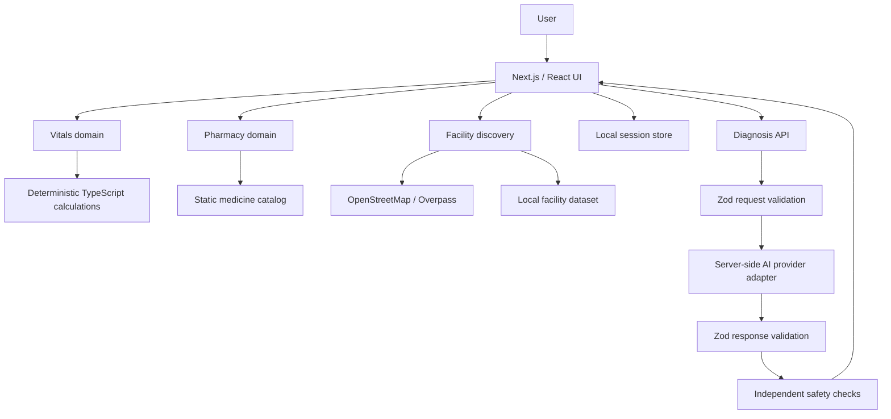

# PakMed 2.0 — Software Design Specification

**Document ID:** DOC-02 · **Version:** 1.0 · **Status:** Draft

## 1. Purpose
This SDS describes the proposed technical design that satisfies the [SRS](./SRS.md). It distinguishes observed repository structure from recommended target structure.

## 2. Design principles
- Separate UI, domain logic, data and external integrations.
- Keep health calculations deterministic.
- Treat generative output and external data as untrusted.
- Validate at system boundaries.
- Keep local functionality independent of remote services.
- Fail safely and communicate degraded states.
- Keep modules independently testable.

## 3. System context



## 4. Technology baseline
| Layer | Technology | Responsibility |
|---|---|---|
| Framework | Next.js 16.1.6 | Routing and application composition |
| UI | React 19 | Interactive components |
| Language | TypeScript 5 strict | Types and domain logic |
| Styling | Tailwind CSS 4 | Design system |
| Validation | Zod | Runtime contracts |
| Persistence | localStorage | Local session ledger |
| Mapping | Leaflet / React Leaflet | Map rendering |
| Geographic data | OSM / Overpass | Facility discovery |
| Offline | Service Worker | Static resource caching |
| Hosting target | Cloudflare Pages / Workers | Hosting, pending compatibility test |

## 5. Component design

### Diagnosis
Target lifecycle: client collects symptom context → POST request → server schema validation → request limits/rate control → provider adapter → output treated as unknown → Zod response validation → independent safety checks → normalized response or controlled error → client rendering with disclaimers.

Schema validity does not establish clinical correctness.

### Vitals
Observed functions in lib/vitals.ts include calculateAsianBmi(), classifyBloodPressure(), classifyGlucose() and classifyHeartRate(). Keep them pure and independent of AI/network services. Validate raw values before calculation. Use unrounded internal values for classification unless the cited reference specifies otherwise; round for presentation. Test boundaries and precedence.

### Session storage
The observed key is pakmed_session_v1. The current implementation uses browser storage and an external-store subscription pattern. Target responsibilities: typed state, version validation/migration, safe defaults, timestamps, subscriptions and explicit reset. Do not store secrets or describe localStorage as encrypted. Reconcile any proposed schema with existing lib/storage.ts before implementation.

### Pharmacy
The current catalog in data/pharmacy_catalog.ts is normalized and searched through lib/pharmacy.ts. Fields include id, brandName, genericName, dosageForm, strength, primaryIndication, prescriptionRequired and approximatePricePKR. Keep catalog data separate from vendor stock. Future records should include source, review date and verification status.

### Facility discovery
Target lifecycle: obtain coordinates with permission or accept manual area → validate coordinates → query Overpass with timeout/cancellation → normalize response → on failure use local reference data → preserve source metadata → render map/list. A local entry is not proof of current operating status.

### Settings
Settings should consume actual persisted state rather than sample data. Reset must define exactly which local keys/records it clears and must not imply deletion from third-party services.

## 6. Recommended target structure
```text
app/
  api/diagnose/route.ts
  components/
  layout.tsx
  page.tsx
data/
  pharmacy_catalog.ts
  facilities.ts
lib/
  vitals.ts
  storage.ts
  directory.ts
  pharmacy.ts
  schemas.ts
  diagnosis/
    provider.ts
    service.ts
    safety.ts
types/
docs/
tests/
  unit/
  integration/
  e2e/
public/
  sw.js
```
This is a target organization, not a claim that every listed file exists.

## 7. Data design
**Medicine:** current normalized fields plus future source, last-reviewed date and verification status.

**Facility:** stable ID, name, coordinates, sourced address/contact, source type, last-reviewed timestamp and verification status.

**Diagnosis:** separate request and response schemas. Avoid retaining raw symptom descriptions without a defined purpose, consent model, retention period and deletion behaviour.

## 8. Error handling
| Failure | Expected handling |
|---|---|
| Invalid form input | Inline validation; no request |
| Invalid API request | 400 response |
| Provider timeout | Bounded wait and controlled unavailable response |
| Invalid provider output | Reject; do not render as success |
| Overpass timeout | Abort; use local data where available |
| Empty facility result | Explicit empty state |
| Corrupt local storage | Recover safe defaults |
| Unsupported browser capability | Explain and offer alternative |

Never expose stack traces, secrets or provider internals to clients.

## 9. Architecture decisions
- **ADR-001 Deterministic vitals:** pure TypeScript logic improves repeatability and testability.
- **ADR-002 Local session:** localStorage avoids centralized patient storage in the current model; it is not encrypted.
- **ADR-003 Static pharmacy catalog:** supports predictable local search; it does not provide live price or stock.
- **ADR-004 OSM/Overpass:** supports geographic discovery; coverage, freshness and uptime are not guaranteed.
- **ADR-005 Server-side AI:** protects credentials and centralizes validation; it does not guarantee medical accuracy.
- **ADR-006 Cloudflare target:** compatibility with framework features, API runtime and dependencies must be demonstrated before production.

## 10. Design verification
The design is acceptable when domain logic is independently testable, external failures are isolated, contracts are enforced, local features work without remote services and deployment compatibility is demonstrated. See [Test Plan](./TEST_PLAN.md).

## 11. Implementation status clarification

The repository contains `app/api/diagnose/route.ts`, but its current behaviour is a basic placeholder using hardcoded responses and keyword-based emergency matching. It does not call an external AI provider. The target provider-adapter flow described above is not yet implemented end-to-end. No `app/api/clinical-brief/route.ts` currently exists.

## 12. Phase 2 target architecture — Planned

Add a separate longitudinal-record domain and repository boundary, deterministic trend engine, patient-context confirmation workflow, bounded AI brief-drafting adapter, ICD-11 terminology adapter and user-reviewed export workflow. Keep the current session store separate. Cloud persistence, local encrypted storage and cross-device sync are distinct design options and require explicit consent, authorization and key-management decisions before implementation.

Do not allow the LLM to calculate vitals, determine trend significance, control emergency escalation, infer medication adherence or verify facility specialties. The complete proposed design is in [Phase 2 specification](./PHASE_2_LONGITUDINAL_CONTEXT.md).
